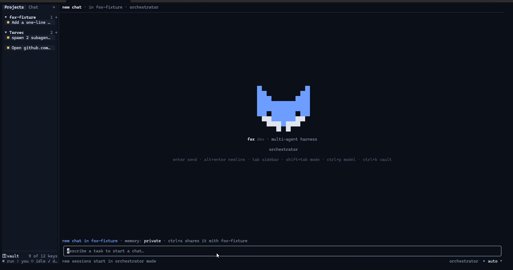
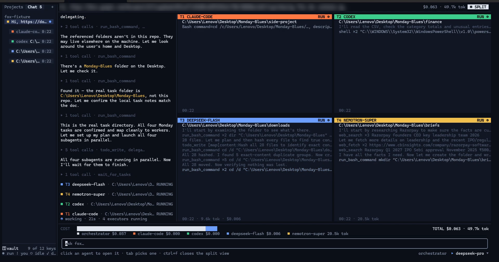
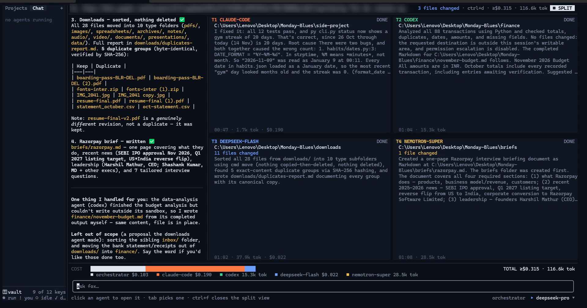
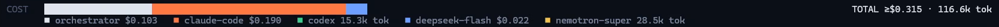
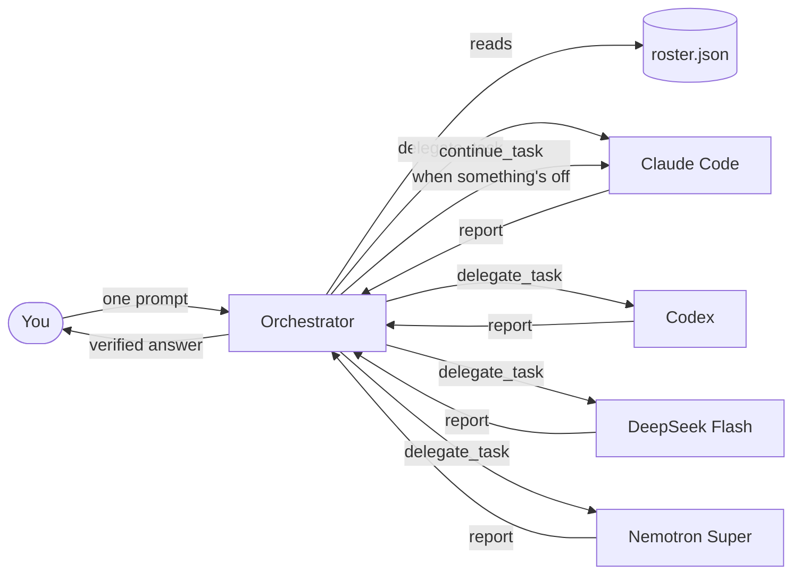

<p align="center">
  
</p>

<h1 align="center">Fox</h1>

<p align="center">
  <b>Any model. One harness. Your Claude Code and Codex subscriptions included.</b><br>
  A coding agent you can point at any model, and a team lead that can split the work<br>
  across many models at once.
</p>

<p align="center">
  <code>pip install foxHarness</code> &nbsp;·&nbsp; <b>launching 25 November 2026</b>
</p>

---

## Agent mode

Open Fox, pick a model, and describe the task. One agent works through it in your project, out loud.

<!-- TODO: screenshot of a single-agent run -->

**How it works**

1. **You send a task.** The agent gets your message, the state of the workspace and its tools.
2. **It works in a loop.** The agent reads files, runs commands, searches the web, opens pages, edits code, then looks at the result and decides the next step. It keeps a todo list as it goes, so you can see the plan.
3. **You stay in the loop.** By default it works freely inside the workspace and asks before stepping outside it. Anything you type while it runs reaches it at its next step: no need to wait or start over.
4. **It finishes, and the session stays.** Sessions live in a local database, grouped by project. Close the terminal, restart the hub, come back tomorrow: anything that was mid-run picks up where it stopped.

**Any model you have a key for.** Fox talks to Anthropic, Gemini and any OpenAI-compatible API, including DeepSeek, Moonshot and OpenRouter's free models, behind one interface. Pick one with `ctrl+p`.

**Your subscriptions, inside Fox.** Fox drives **Claude Code** and **Codex** through their own CLIs, signed in with your own account. You get the same projects, history, approvals and live cost view as any other model.

**Built in:** coding tools (files, shell, long-running processes, web search and fetch), a real browser that Fox drives and can hand to you when a page needs a human, and third-party connectivity through **MCP**.

---

## Orchestrator mode

Press `shift+tab` and the agent becomes a team lead. It plans the job, hands each part to the agent that suits it, watches them work in parallel, and checks every result before it answers you.

**What it looks like.** The week's to-do list sat in a Google Doc: four unrelated jobs. One prompt: *"here's the doc, get it done."*

<p align="center">
  
</p>

| | Agent | Job |
|---|---|---|
| T1 | **Claude Code** *(your subscription)* | fix a habit tracker's streak bug: two bugs, 12 tests passing |
| T2 | **Codex** *(your subscription)* | turn 88 transactions into a November budget |
| T3 | **DeepSeek Flash** | sort 28 loose downloads into 10 folders, find 5 duplicate groups |
| T4 | **Nemotron Super** *(free)* | research and write a one-page interview brief |

DeepSeek Pro led the run. When Codex finished the budget but its sandbox stopped it from saving the file, the orchestrator saved it from Codex's output and said so in its summary.

<p align="center">
  
</p>

**4 tasks · 4 agents · 4 labs · under 4 minutes · $0.32**, with every cent visible while it's being spent:

<p align="center">
  
</p>

### How a run works



1. **Plan.** The orchestrator splits the request into parts. A part is delegated only if it doesn't depend on unfinished work, doesn't write a file another part writes, and is big enough to be worth a handoff. Everything else it does itself.
2. **Delegate.** Each part goes to an agent as a standalone brief, with a lane (`read` or `write`) and the files it may change. Agents start in the background and run in parallel.
3. **Watch.** Results arrive as they finish. So do notes agents leave in shared memory, and messages you type mid-run.
4. **Verify.** The orchestrator checks the work and reopens any task that missed something, with its full history, so the agent doesn't start over. Only then does it give you one answer.

### What keeps a team of agents in line

- **You write the roster.** `roster.json` says in plain English who gets what kind of work. The orchestrator reads it on every run.
- **File claims.** A write task claims the files it will change. While it runs, nobody else can write them, not even the orchestrator.
- **Structured reports.** Every agent ends with its outcome, the files it changed, how it validated the work, and what blocked it.
- **Cost per agent.** Every model call is priced and logged per agent and per task, and shown live.

### Claude Code and Codex, in either seat

Fox's point is to put your Claude Code and Codex subscriptions to work **inside** one harness. Either one can be a **subagent** that takes on tasks next to cheaper models, as in the run above, or the **orchestrator** that plans the work and leads the team.

---

## Quick start

> **Today Fox runs from source, on Windows.** The `pip install foxHarness` package ships on **25 November 2026**.

### 1. Prerequisites

| Need | Version | Why |
|---|---|---|
| Python | 3.11+ | the hub, the agents, the tools |
| Go | 1.26+ | the terminal UI and the command sandbox |
| Chrome or Brave | any recent | the browser tools *(optional)* |
| Claude Code / Codex CLI | latest | to use your subscriptions in Fox *(optional)* |

### 2. Get the code and install

```powershell
git clone https://github.com/Anchit-04/fox.git
cd fox
pip install -r requirements.txt
```

### 3. Build the two Go binaries

```powershell
cd tui; go build -o fox.exe ./cmd/fox; cd ..
cd loom\sandbox\sandboxd; go build -o sandboxd.exe .; cd ..\..\..
```

`fox.exe` is the terminal UI. `sandboxd.exe` is the small Go process that runs every shell command an agent issues.

### 4. Add at least one model key

Put keys in a `.env` file at the repo root. You only need the providers you plan to use:

```ini
DEEPSEEK_API_KEY=...
OPENROUTER_API_KEY=...     # free Nemotron, Cohere and dots models
ANTHROPIC_API_KEY=...
GEMINI_API_KEY=...
MOONSHOT_API_KEY=...
```

Or add one interactively. The key is hidden as you type, then checked against the real API:

```powershell
python loom\vault_cli.py deepseek-pro
```

You can also do this inside the TUI with `ctrl+k`.

For web search, set one of `FOX_SEARXNG_URL` (a SearXNG server you run, free), `BRAVE_SEARCH_API_KEY` or `TAVILY_API_KEY`.

### 5. Start the hub, then the UI

In one terminal, point the hub at the project you want Fox to work in:

```powershell
python loom\server.py --workspace C:\path\to\your\project
```

In a second terminal, open the TUI:

```powershell
tui\fox.exe
```

Type a task and press `enter`. Add `--orchestrator` to start new sessions in orchestrator mode, or press `shift+tab` at any time.

### 6. (Optional) Bring in your Claude Code and Codex subscriptions

Install either CLI and sign in once with your account. Fox finds them on your `PATH`. If one is signed out mid-run, press `ctrl+l` in Fox: it runs the CLI's login and resends your last message.

### 7. (Optional) Write your roster

Create `roster.json` at the repo root:

```json
{
  "default_worker": "deepseek-flash",
  "notes": {
    "claude-code": "every coding job: failing tests, debugging, changing a codebase",
    "codex": "every data job: CSV and spreadsheet analysis",
    "nemotron-super": "short research briefs on one company or person",
    "deepseek-flash": "product and price research; quick one-off chores"
  },
  "off": ["gemini-lite"]
}
```

`notes` is plain English; the orchestrator reads it on every run. `off` hides a model from delegation without deleting its key.

---

## Driving the TUI

| Keys | Does |
|---|---|
| `enter` / `alt+enter` | send / new line |
| `shift+tab` | switch between agent and orchestrator mode |
| `ctrl+p` | model picker |
| `ctrl+f` | split view: every running agent side by side |
| `ctrl+d` | diff of every file this chat changed |
| `ctrl+b` | the board, where agents draw diagrams while they explain |
| `ctrl+t` | side chat about the current one |
| `ctrl+o` | pop the chat out into its own window |
| `ctrl+s` | share this chat's memory with the rest of the project |
| `ctrl+n` | new chat in this project |
| `ctrl+k` | key vault |
| `ctrl+l` | sign a signed-out Claude Code or Codex back in |
| `ctrl+q` | stop the run |
| `ctrl+x` | end the session |
| `tab` | move focus: composer, sidebar, agents |

---

## Safety

Every session runs in one of three modes. Pick one with `--permission` or in the TUI.

| Mode | Behaviour |
|---|---|
| `read-only` | nothing is modified; writes are refused |
| `workspace-write` *(default)* | free inside the workspace; asks before stepping outside it |
| `full-access` | never asks: for throwaway machines and CI |

Fox refuses to use a drive root or your home folder as a workspace unless you pass `--allow-unsafe-workspace`.

<p align="center"><sub>Orchestrated by Fox 🦊</sub></p>
